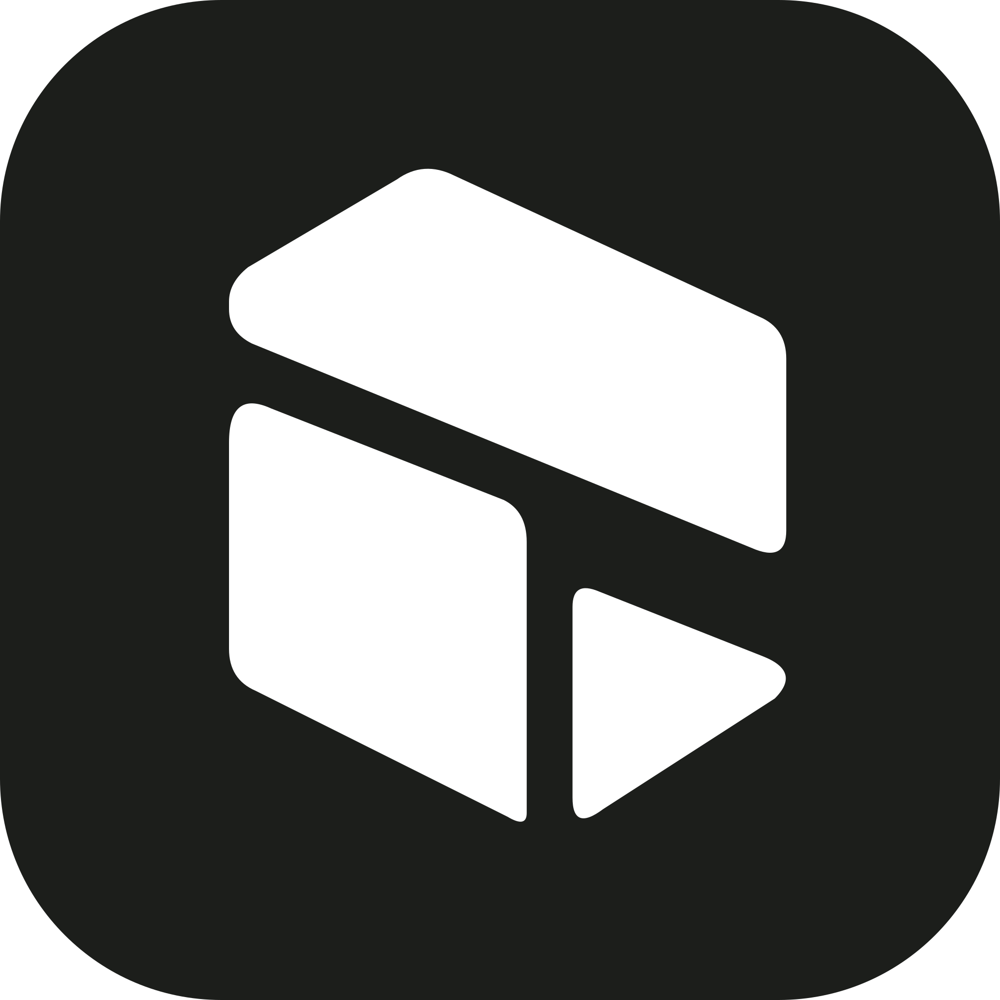
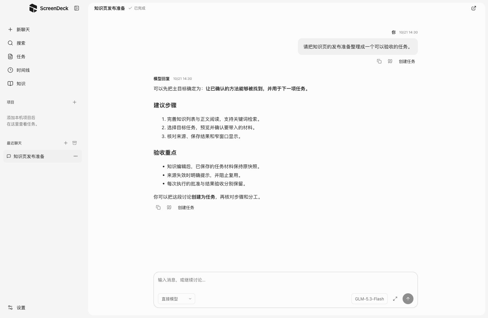
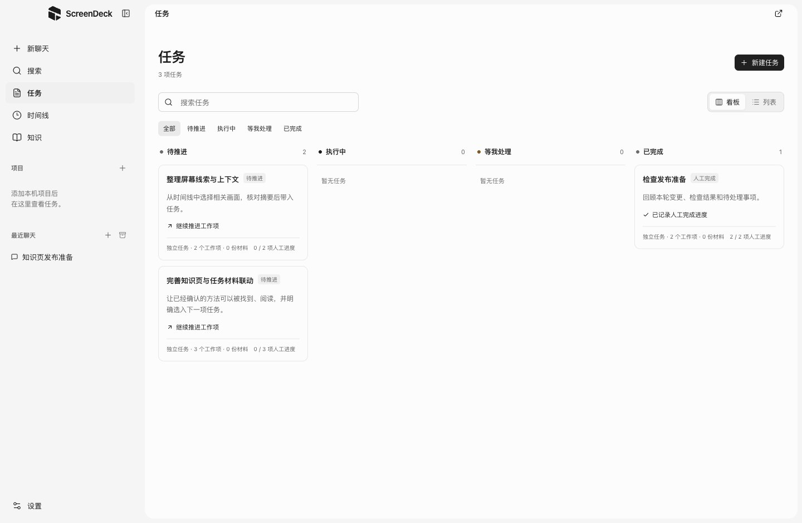
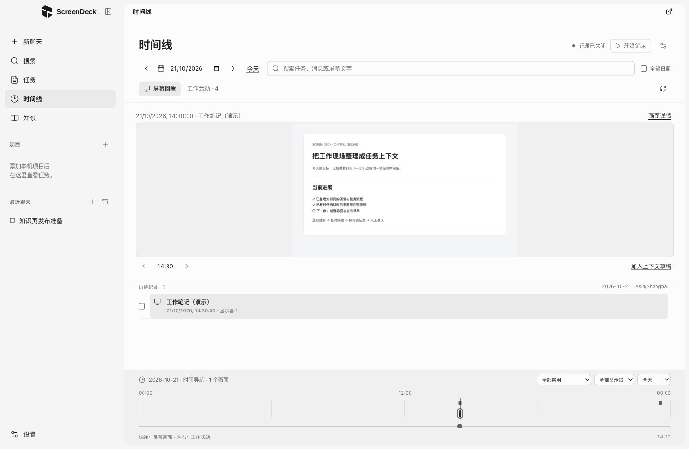
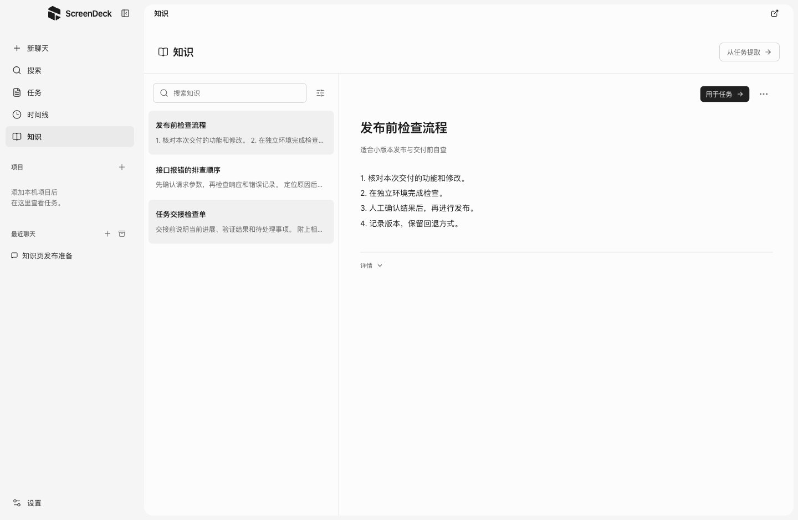
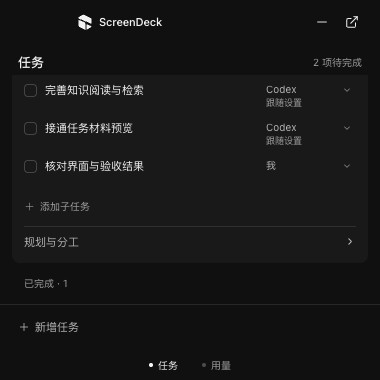

<p align="center">
  
</p>

<h1 align="center">ScreenDeck</h1>
<p align="center"><strong>把屏幕线索、Agent 执行与知识沉淀，串成同一项任务。</strong></p>
<p align="center">本地桌面 AI 工作台 · React + Electron + TypeScript · 开发预览版</p>

ScreenDeck 围绕“下一步要推进什么”组织工作：从聊天或屏幕现场整理目标，拆成可核对的步骤，交给 Codex、OpenCode 或自己处理，再把验收后的方法留给下一项任务。

任务、会话、屏幕记录与知识保存在本机；推理和工具执行由你选择的模型服务或 Agent 提供。当前主要在 macOS 上开发和验证。

[演示视频](#演示视频) · [快速开始](#快速开始) · [页面预览](#页面预览) · [配置连接](#配置连接) · [当前范围](#当前范围) · [开发说明](desktop/README.md)

## 演示视频

https://github.com/user-attachments/assets/de9cfc05-ee79-4eb0-96a7-85c1163280b2

视频展示产品理念与任务协作流程；当前已实现能力和后续范围见下文。

## 可以做什么

| 模块 | 当前能力 |
| --- | --- |
| 聊天 | 直接模型、Codex 与 OpenCode；流式回复、Markdown、代码复制、引用、搜索和归档，从已完成消息创建任务。 |
| 任务 | 独立任务或可选项目归属；看板／列表、主目标、完成条件、材料、子任务与依赖，主窗口和 Deck 共用已保存版本。 |
| 规划与分工 | 用已配置的生成模型提出步骤草稿；核对和修改后保存，可通过 TypeSafe Jev 比较实际执行候选。 |
| 原生执行 | 调用 Codex／OpenCode 的文件与命令工具；冻结当次输入、确认开始、处理工具审批、查看证据并人工验收。 |
| 屏幕时间线 | 按间隔采集屏幕与 OCR，记录显示器及应用／窗口元数据，按日期、应用和文字回看；核对后将线索选入任务。 |
| 知识 | 从已接受成果中人工提取方法与结论；搜索、编辑、归档、核对来源，预览并选入其他任务的材料。 |
| Deck | 紧凑任务浮窗；带刘海的 Mac 支持顶部悬停展开，无适配条件时使用普通浮窗，可创建目标、规划步骤和调整分工。 |

### 一项任务怎样推进

1. **保存目标**：直接新建，或从一条已完成的聊天消息创建；项目、材料与完成条件按需补充。
2. **核对计划**：生成步骤、依赖和分工，必要时参考 Jev 建议，修改后明确保存。
3. **逐项执行**：选择工作目录、权限和材料，核对冻结输入后批准开始，处理原生工具审批。
4. **检查成果**：查看具体产物及检查证据，人工接受或退回；中断和未知状态保留原记录。
5. **留下方法**：从已接受的结果整理知识，下一次使用时保存明确的内容快照。

## 页面预览

以下为当前界面的隔离截图。任务、聊天、知识和屏幕画面均为演示数据，未使用私人记录或真实模型回复。

### 聊天：讨论与任务在同一工作台



### 任务：看清目标、进度和下一步



### 时间线：找回当时的屏幕现场



### 知识：阅读方法，明确用于下一项任务



<details>
<summary>查看 Deck 紧凑任务浮窗</summary>

<p align="center"></p>

截图展示普通浮窗形态。刘海模式沿用同一任务内容，在适配的显示器上顶部停靠。

</details>

## 快速开始

需要 Git、npm 和 Node.js 22.12+；CI 使用 **22.21.1**。macOS 的原生辅助程序构建需要 Xcode Command Line Tools，屏幕采集辅助程序按 macOS 14+ 编译。首次安装需要联网下载依赖和 Electron。

```sh
git clone https://github.com/SUertee/screen-deck.git
cd screen-deck/desktop
npm ci
npm run dev
```

已有构建时可运行 `npm start`。完整开发、隔离检查和 macOS 预览包命令见 [desktop/README.md](desktop/README.md)；当前主线合并不会自动发布安装包。

## 配置连接

| 入口 | 配置方式 |
| --- | --- |
| 设置 → 模型服务 | 填写 Chat Completions 兼容的 HTTPS API 地址与密钥，校验模型列表并选择模型；服务不提供列表时可明确手工填写。 |
| 设置 → Agent 设置 → Codex | 安装兼容的 Codex CLI **0.133.0**，显式连接并使用 ChatGPT 登录；登录凭据由 Codex 管理。 |
| 设置 → Agent 设置 → OpenCode | 安装兼容的 OpenCode **1.19.0**，选择程序并连接；当前通过 **ACP v1** 接入，使用已保存的模型服务配置。 |
| 设置 → Agent 设置 → 任务分工判断 / Jev | 配置 TypeSafe 专用 API Key，默认模型为 `jev-latest`；发送前核对内容和调用费用。此项不加入执行 Agent 列表。 |
| 时间线 → 开始记录 | 按系统提示授予屏幕录制权限，再选择显示器和排除应用；可停止记录并配置留存。 |

普通聊天不要求先创建项目或任务。需要文件和命令工具时，选择执行目录及“变更前确认／自动编辑／完全访问”；具体策略由对应 Agent 实际支持的能力决定。Jev 用于候选判断，步骤正文由生成模型提出。

## 本地数据与权限

应用默认数据目录为 `~/.screendeck/`：

| 内容 | 位置 |
| --- | --- |
| 正式任务与计划／队列记录 | `tasks/<任务 ID>/` |
| 模型聊天、Agent 会话 | `sessions/`、`agent-sessions-v1/` |
| 项目目录登记 | `projects/directory-index.json` |
| 知识卡片 | `knowledge-v1/` |
| 屏幕画面、OCR 和采集设置 | `screen-recordings/` |

Task 保存目标与交接；Project 是可选归属和默认目录；Session 保存实际对话、执行目录及原生绑定；执行尝试关联当次任务版本、结果和验收。项目目录不等于系统沙箱。

API Key 按当前实现以明文保存在本机私有文件中，文件权限为 `0600`；聊天与屏幕记录也未加密。模型请求会发送给你配置的服务；Agent 按实际权限访问资料，并交给自己的模型服务处理。打开时间线或保存一份计划不会自动调用模型或开始执行。

旧 Electron 数据按兼容流程迁入正式目录，原记录保留；原生登录目录可能继续沿用旧路径。旧项目 task/run 历史保持只读；冻结的 Swift 原型位于 [archive/swift-prototype](archive/swift-prototype/README.md)。

## 当前范围

这是开发预览版。任务规划、单项原生执行、人工验收及知识复用已接通，以下能力仍在后续范围：

- 无人值守的整份计划连续调度、原生会话跨应用重启续接。
- Agent 原生模型自由切换、统一账户额度和用量汇总。
- 宿主独立运行构建／测试命令并形成可信收据。
- 自动采集知识、生成或安装 Skill、个人日报、云端／跨设备同步。
- 公开发行签名、公证，以及 Windows 的完整安装和功能验收。

屏幕记录是**离散画面采集与 OCR**，当前不包含音频；显示器上的窗口归属信息不等于精确窗口焦点。停止接收和远端取消分别记录，未知结果不会自动重发；人工进度勾选也不等于 Agent 产物已验收。

## 开发与验证

```sh
cd desktop
npm run typecheck
npm test
npm run build
```

[`Desktop checks`](.github/workflows/desktop-checks.yml) 在 macOS 上检查类型、单元测试、构建和记录校验器。界面、真实账户、长期采集和发行安装另行验证；隔离 Electron 脚本入口见 [桌面说明](desktop/README.md)。

代码入口：`desktop/src/renderer` 为界面，`src/main` 为进程与 IPC，`src/core` 为会话／任务／审批，`src/shared` 为契约。开发从最新 `dev` 建立 `feat/*`、`fix/*` 或 `docs/*` 分支；集成版本通过 `dev → main` PR 和必需检查合入，长期分支保留 merge commit。

完整协作约定见 [AGENTS.md](AGENTS.md)。`docs/` 与 `AGENTLOG.md` 是本机资料，按现有规则不随仓库克隆；公开使用和开发入口以本 README 与 [desktop/README.md](desktop/README.md) 为准。
